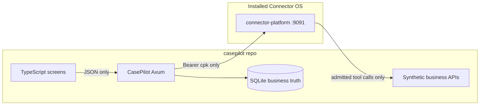
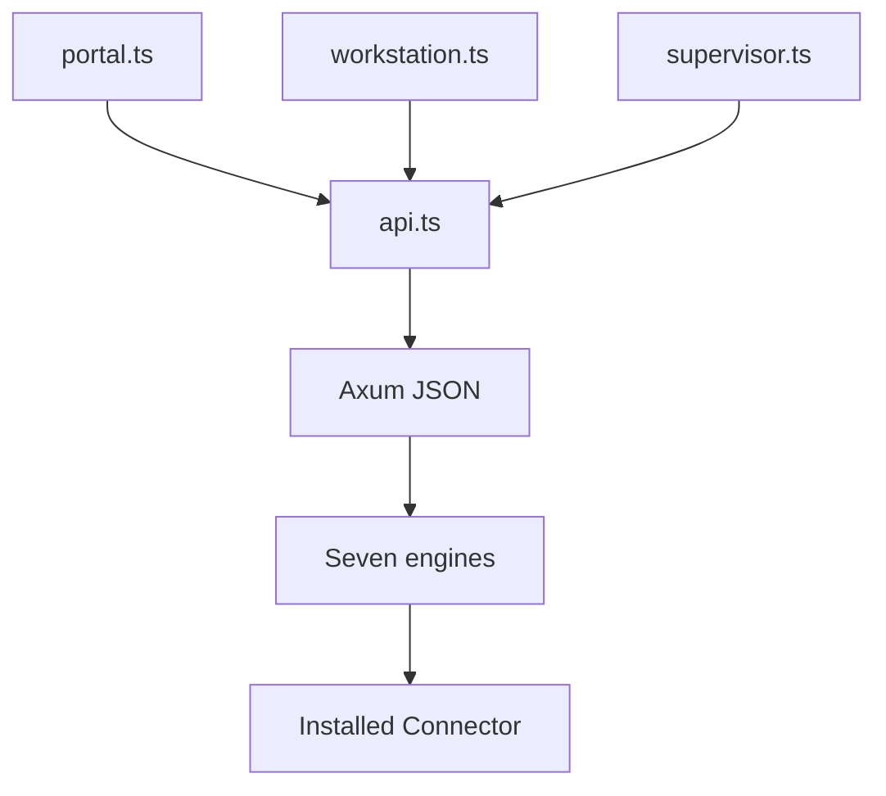

# CasePilot on a Connector OS build package

This is the architecture plan for the project in `/home/umesh/Projects/casepilot`.
Connector OS is consumed as an installed build. CasePilot code does not live in the Connector repository.


CasePilot is a separate repository and a separate process. Connector OS is an installed product. CasePilot never joins the Connector Cargo workspace, never vendors Connector crates, and never clones this tree to run.

## Boundary



- Business truth stays in CasePilot SQLite: cases, issues, evidence digests, plans, assignments, intended actions, approvals, observed results, verified outcomes.
- Connector keeps agent identity, workspace, VAC memory, the dynamic agent loop, PATE, ToolDispatch, Cease, and receipts.
- VAC is not the order, refund, or case-status database.
- The Python SDK under [oss/sdks/python/connector/__init__.py](oss/sdks/python/connector/__init__.py) is in-process and is not the client. CasePilot ships a small HTTP client aimed at the installed platform.

## Where the code lives

Project directory: `/home/umesh/Projects/casepilot`. It is not inside the Connector OS repository.

```text
casepilot/
  src/main.rs                 one Axum process
  src/engines/                seven modules, not seven services
  src/connector_client.rs     HTTP only
  src/world/                  orders, customers, shipping, refunds, notify
  src/db/                     schema and transactions
  web/                        plain TypeScript, no React
    api.ts                    typed fetch to CasePilot only
    portal.ts                 customer
    workstation.ts            case operator
    supervisor.ts             supervisor
  deploy/connector.pin        version, URL, sha256
  deploy/install-connector.sh downloads the tarball, verifies, installs
```

## Connector as a downloaded package

Pin a released artifact, not `git clone` and not `./up.sh`.

Documented package: `dist/connector-os-<ver>-<arch>-linux.tar.gz` plus `dist/SHA256SUMS`, produced by [.github/workflows/connector-os-release.yml](.github/workflows/connector-os-release.yml) and described in [platform/deploy/PACKAGING.md](platform/deploy/PACKAGING.md).

```bash
# from casepilot/deploy, using connector.pin
curl -fsSL -o connector-os.tar.gz "$TARBALL_URL"
sha256sum -c SHA256SUMS
tar -xzf connector-os.tar.gz
sudo ./install.sh
sudo systemctl enable --now connector-platform
```

Installed layout is fixed: `/usr/local/bin/connector-platform`, `/usr/local/bin/connectorctl`, `/etc/connector/env`, `/var/lib/connector`. CasePilot data stays in `/var/lib/casepilot`.

`deploy/install-connector.sh` refuses to continue if the checksum does not match. It does not build Connector from source.

Linux/KVM seven-backend install stays a second, explicit step using the installed `connectorctl` and a digest-pinned `deployment.json`, as in [platform/docs/OPERATOR.md](platform/docs/OPERATOR.md). CasePilot records `connectorctl product status` and `connectorctl govern deploy-verify linux-kvm` in its deployment note. Any backend that is not `READY` is labeled simulated or unproven. Cosign checks the Connector release manifest only. It is not treated as proof that a refund happened.

## One process, seven engines

Single Rust/Axum binary. SQLite is the MVP store so CasePilot does not share Connector’s Postgres.

| Engine | Owns | Calls Connector | Never does |
|---|---|---|---|
| Case | Intake, status, issues | Starts one workbench session per case | Store status in VAC |
| Investigation | Facts and evidence digests | Memory write/recall on the investigator identity | Mutate orders |
| Coordination | Three role identities, one case task | Register, setup, activate, workbench turn | Run its own agent framework |
| Decision | Rules, approval rows with scope and expiry | Reads Ask / HITL; does not grant | Treat a model answer as permission |
| Action | Intended effects and idempotency keys | Tool invoke only after the case task exists | Call refund or replacement except as the tool Connector admitted |
| Verification | Observed state versus intent | Receipts and explain; governed reads | Mark success from assistant text |
| Continuity | Reopen, generation, prior outcome | Memory plus cease-proof; new admission on resume | Reuse a ceased generation |

## UI connection

The three screens are plain TypeScript. No React, and no second UI framework. The Rust Axum process is the only backend. It compiles or serves the TypeScript as static files and exposes JSON under `/api/casepilot`.

The browser never calls Connector on `:9091`, never holds the `cpk_` key, and never calls orders, shipping, or refunds. A screen action is one `fetch` to CasePilot. CasePilot writes SQLite, then calls Connector when the engine requires it.



Shared client in `web/api.ts`: `getJson`, `postJson`, and types for case, evidence, plan, approval, receipt, and outcome. Screens render into the page with the DOM API. CasePilot session cookies identify the customer, operator, or supervisor. Connector auth stays on the server.

### Customer portal

| Screen action | CasePilot route | Engine | Connector |
|---|---|---|---|
| Submit complaint | `POST /api/casepilot/cases` | Case, then Coordination | Register three agents and open one workbench session after the case row exists |
| List my cases | `GET /api/casepilot/cases?customer=` | Case | None |
| Open one case | `GET /api/casepilot/cases/:id` | Case, Verification | None on read of business status |
| See resolution | same GET, `case_outcomes` | Verification | Receipt ids are displayed, not fetched by the browser |

The portal shows verified outcome and remaining status. It has no approve, cease, refund, or tool button.

### Caseworker workstation

| Screen action | CasePilot route | Engine | Connector |
|---|---|---|---|
| Open queue | `GET /api/casepilot/work/queue` | Case | None |
| Run investigation | `POST /api/casepilot/cases/:id/investigate` | Investigation, Coordination | Workbench turn on the investigator; memory write and recall |
| Ask for policy | `POST /api/casepilot/cases/:id/policy` | Coordination, Decision | Workbench turn on the policy agent; read-only |
| Propose replacement | `POST /api/casepilot/cases/:id/actions` body `replacement` | Action | Tool invoke or workbench admit on the resolution agent |
| Propose refund | same route, body `refund` | Decision, Action | Same admit path; over-limit returns `approval_required` and does not write a refund |
| Show evidence and receipts | `GET /api/casepilot/cases/:id/evidence` | Investigation, Verification | Server reads receipts and explain; response includes receipt id and verified flag |

Propose returns one of `admitted`, `denied`, or `approval_required`. The workstation renders that state. It does not retry a denied effect by calling a business URL.

### Supervisor console

| Screen action | CasePilot route | Engine | Connector |
|---|---|---|---|
| Pending approvals | `GET /api/casepilot/approvals` | Decision | Server reads Connector HITL pending |
| Approve one refund | `POST /api/casepilot/approvals/:id/approve` | Decision, then Action | HITL approve, then the same effect is submitted again |
| Deny | `POST /api/casepilot/approvals/:id/deny` | Decision | HITL deny; no business write |
| Cease case agents | `POST /api/casepilot/cases/:id/cease` | Continuity | `POST /api/v1/agents/:pid/cease` for the case identities |
| Resume | `POST /api/casepilot/cases/:id/resume` | Continuity, Coordination | New generation and a new workbench admission |
| Deployment truth | `GET /api/casepilot/deployment` | none | Server shells `connectorctl product status` and deploy-verify; UI shows READY or the named gap |

Approval in the console records principal, scope, and expiry in SQLite. The following admit still goes through PATE. Cease disables further action buttons until resume returns a new generation.

### What the TypeScript layer does not do

- No import from Connector’s Leptos dashboard or `oss/sdks`.
- No `OPENAI_BASE_URL` pointed at Connector from the browser.
- No direct `fetch` to synthetic business services.
- A successful chat string on screen is not rendered as a completed refund. The outcome panel binds to `verified_status` and `receipt_id` from the Rust API.

## Mediated execution

PATE is not a separate URL. Admission happens inside Connector handlers. CasePilot uses the workbench façade in [platform/server/src/services/workbench.rs](platform/server/src/services/workbench.rs): a turn proposes, an admit dispatches.

Service account: `Authorization: Bearer cpk_…` from `/etc/connector/env`. SPIRE is the node workload identity, not CasePilot’s REST credential.

Per case, Coordination registers three Connector agents and keeps their pids on `agent_assignments`:

- Investigator and policy analyst: read-only tools, no business writes.
- Resolution executor: scoped action tools. It cannot approve itself.

One workbench session is the case’s authoritative task. All three roles act inside that case id. Pending tool orders are admitted on the resolution identity only.

External effect path:

1. Action inserts `case_actions` with an idempotency key. Status is `proposed`.
2. CasePilot calls `POST /api/v1/tools/mcp/invoke` or workbench admit. The tool implementation is a CasePilot localhost handler.
3. `pate_not_proceed` or `ask_hitl`: no business write. Approval rows store principal, scope, and expiry.
4. Supervisor approval calls Connector HITL approve, then the same effect is submitted again. The earlier approval is evidence for that re-evaluation, not a permanent grant.
5. Only a Proceed that Connector actually dispatches reaches orders, shipping, or the simulated refund service. Those listeners accept only the dispatch Connector just admitted, keyed by the idempotency key.
6. Verification stores `receipt_id` from `GET /api/v1/agents/:pid/audit/receipts` or `GET /api/v1/runtime/explain/:receipt_id`, then issues a governed read. `case_outcomes.verified_status` changes only when that read matches the intended effect.

Cease from the supervisor console is `POST /api/v1/agents/:pid/cease`. Further invokes must fail on the old generation. Resume creates a new generation and a new admission. CasePilot does not keep a side door to the refund service.

Synthetic world services (orders, customers, shipping, refunds, notifications) live in the CasePilot repo and bind to localhost. They are not Connector plugins checked into this repository.

## MVP slice after this plan

Implement in this order, still entirely under the sibling repo:

1. Pin file, checksummed install script, and a Connector HTTP client smoke test against `:9091/healthz`.
2. SQLite schema for the nine business entities and intake that creates a case without calling Connector.
3. Register the three agents and open one workbench session for that case.
4. One replacement under the limit, one refund that returns Ask, supervisor approval, re-admission, receipt, and a governed read.
5. Cease, failed resume on the old generation, successful resume on a new generation.
6. Plain TypeScript portal, workstation, and supervisor screens for that same flow, each calling only `/api/casepilot`.

No files in `connector-oss` change for this work.
